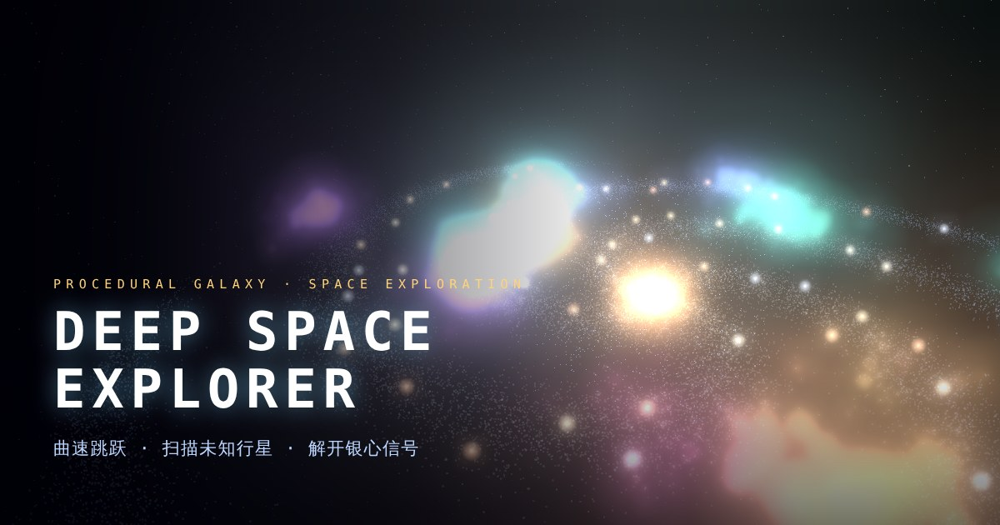

# Deep Space Explorer



驾驶探索飞船穿越一座程序化生成的旋臂星系：跳跃到陌生恒星系，扫描未知行星，收集样本换取信用点，升级飞船，去往更远的深空。主线「银心信号」：收集 7 块先驱者留下的信号碎片，抵达银河中心，扫描那颗奇点。

纯前端项目（Three.js + 原生 ES Modules），无需构建。当前版本：**v0.1.0**

## 操作

| 按键 | 作用 |
| --- | --- |
| 鼠标 | 转向（点击画面锁定鼠标，Esc 释放）；方向键也可转向 |
| W A S D | 前进 / 左移 / 后退 / 右移 |
| 空格 / C | 上升 / 下降 |
| Q E | 滚转 |
| Shift | 推进加速（消耗能量） |
| Tab / G | 切换目标恒星 / 启动或取消曲速（消耗燃料） |
| 鼠标左键 / F | 瞄准行星并按住扫描 |
| R | 对选中的目标恒星远程探测（消耗燃料） |
| M / J / U | 银河星图 / 探索日志 / 飞船升级 |
| B | 开关辉光效果 |

## 本地运行

项目使用 ES Modules，**不能直接双击 `index.html` 打开**（浏览器会因跨域限制拒绝加载模块），需要用一个本地 HTTP 服务器：

```bash
# 任选其一
python3 -m http.server 8000
npx http-server -p 8000 -c-1
npm start            # 等同于 python3 -m http.server 8000
```

然后访问 <http://localhost:8000>。

> Three.js 通过 jsDelivr CDN 加载（见 `index.html` 里的 importmap），运行时需要联网。

## 部署到 GitHub Pages

1. 把整个文件夹推送到 GitHub 仓库。
2. 仓库 **Settings → Pages**，Source 选 `Deploy from a branch`，分支选 `main`、目录 `/ (root)`。
3. 稍等片刻即可访问 `https://<用户名>.github.io/<仓库名>/`。
4. **分享预览图**：`index.html` 里的 `og:image` / `twitter:image` 目前是相对路径 `assets/thumbnail.jpg`，大多数社交平台要求**完整网址**。部署后请把这两处改成：
   `https://<用户名>.github.io/<仓库名>/assets/thumbnail.jpg`

## 项目结构

```
deep-space-explorer/
├── index.html          页面结构、HUD、面板、importmap
├── css/
│   └── style.css       界面样式
├── js/
│   ├── main.js         主程序：状态、渲染、LOD、输入、曲速/扫描/任务、主循环、界面
│   ├── constants.js    版本号与全局常量、剧情文本
│   ├── rng.js          可复现的伪随机数（种子）
│   ├── universe.js     程序化生成：星系、背景星、星云、恒星系、行星
│   ├── story.js        主线碎片所在星系的生成规则
│   ├── graphics.js     行星贴图、点云等绘制工具
│   └── audio.js        合成音效（无需音频文件）
└── assets/
    └── thumbnail.jpg   分享预览图（1200×630）
```

## 存档与种子

- 进度保存在浏览器 `localStorage`（键 `deepspace-explorer-save-v1`），辉光偏好键为 `deepspace-bloom`。
- 同一个种子永远生成同一个银河。默认种子 `42`，可用 URL 参数指定，例如 `?seed=1234`；开始界面的「新的银河」会随机换一个。

## Roadmap

### v0.2.0（计划中）
- [ ] 每颗行星加入地表图片，包含微观生命体（macro life creatures）
- [ ] 多恒星系统（双星 / 三星）

## 已知问题

- [ ] 新游戏的出生点偏离「家园恒星」，开局画面可能被附近恒星的强光过曝。（计划在下个版本优化）

## 许可

尚未选择许可证。公开仓库前请自行添加 `LICENSE` 文件（如 MIT）。
