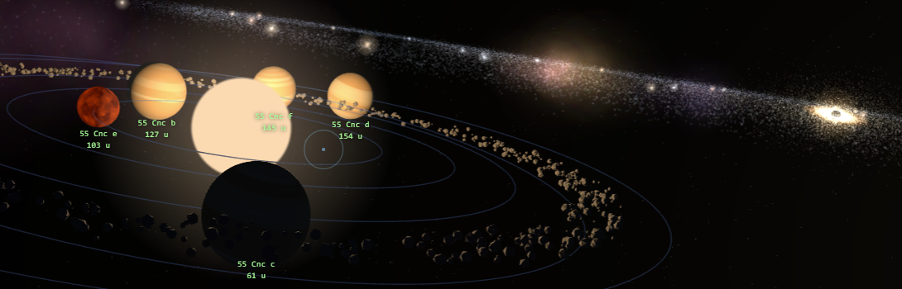

# Deep Space Explorer



驾驶探索飞船穿越一座程序化生成的旋臂星系：跳跃到陌生恒星系，扫描未知行星，收集样本换取信用点，升级飞船，去往更远的深空。主线「银心信号」：收集 7 块先驱者留下的信号碎片，抵达银河中心，扫描那颗奇点。

纯前端项目（Three.js + 原生 ES Modules），无需构建。当前版本：**v1.0.0-alpha**

## 玩法

- **探索**：用曲速在恒星系之间跳跃；单星、双星、三星系统各有不同的轨道与光照；行星分岩石、气态、冰巨三类。出发星系是真实的太阳系，银河里还有一批真实存在的恒星系统（比邻星、TRAPPIST-1、Kepler-16 等），数据来自天文观测，界面上用「实测 / 推测 / 生成」标签区分；每局还会随机启用几类特殊现象（红矮星、红巨星、热木星、熔岩行星、海洋世界、超级地球、紧凑多行星、环双星）。
- **扫描与收藏**：瞄准行星按住扫描，获得信用点、燃料与经验，并收藏一张行星卡片（K 键查看，可按星系筛选）；同时采样资源进入货舱。按 P 可以随时拍摄当前星系的全景图，扫完一个星系的全部行星时也会自动拍一张（收藏夹的「星系全景」标签）；全景图上写着主恒星的类型、温度和耀斑范围，不需要再扫描恒星。升级扫描仪后可按住鼠标右键或 V 范围扫描。
- **货舱与升级**：货舱（I 键）里的材料可以加注燃料、修补船体、作为升级材料，也可以出售换取信用点；信用点和材料用来升级飞船（U 键）。
- **信号**：星系里散布着补给、求救、遗迹、干扰四类信标，强度不同，走近才能识别；干扰信号是陷阱。
- **危险**：恒星耀斑与高温区（越近越危险）、小行星带、船体失效，越接近银心越危险；银心奇点还有引力潮汐，必须靠近才能扫描。
- **主线**：收集 7 块信号碎片，每块都指向下一个星系，最终前往银河中心。
- **知识库**：按 L 打开。第一次遇到的恒星类型、行星类别、双星三星、真实星系、小行星带、耀斑等，会弹出介绍并收进知识库，没遇到过的不显示；「基础知识」里还有行星卡上 AU、R⊕、M⊕ 等天文单位的说明。经验够了会邀请知识测验，答对加经验。
- **新手教学**：按你的进度分阶段弹出，不用背操作。
- **结局**：越过奇点的不可回头点会失败；成功扫描奇点能解锁先驱者的讯息，可继续探索。

## 操作

| 按键 | 作用 |
| --- | --- |
| 鼠标 | 转向（点击画面锁定鼠标，Esc 释放）；方向键也可转向 |
| W A S D | 前进 / 左移 / 后退 / 右移 |
| Z / C | 上升 / 下降 |
| Q E | 滚转 |
| Shift | 推进加速（消耗能量） |
| Tab / G | 切换目标恒星 / 启动或取消曲速（消耗燃料） |
| 鼠标左键 / F | 瞄准行星（或银心奇点）并按住扫描 |
| 鼠标右键 / V | 范围扫描（升级扫描仪后）：把准星外圈里的行星一起扫 |
| R | 对选中的目标恒星远程探测（消耗燃料） |
| M / J / U  | 银河星图 / 探索日志 / 飞船升级 |
| K / I / L | 收藏 / 货舱 / 知识库 |
| P | 拍摄当前星系的全景图 |
| H | 帮助（操作与游戏说明） |
| ← → | 在放大的卡片里查看前一张 / 后一张 |
| Enter / Space | 关闭介绍弹窗、教学中的「继续」 |
| B | 开关辉光效果 |

## 本地运行

项目使用 ES Modules，**不能直接双击 `index.html` 打开**（浏览器会因跨域限制拒绝加载模块），需要用一个本地 HTTP 服务器：

```bash
# 任选其一
python3 -m http.server 8000
npx http-server -p 8000 -c-1
npm start            # 等同于 python3 -m http.server 8000
```

然后访问 <http://localhost:8000>。

> Three.js 通过 jsDelivr CDN 加载（见 `index.html` 里的 importmap），运行时需要联网。

## 部署到 GitHub Pages

1. 把整个文件夹推送到 GitHub 仓库。
2. 仓库 **Settings → Pages**，Source 选 `Deploy from a branch`，分支选 `main`、目录 `/ (root)`。
3. 稍等片刻即可访问 `https://<用户名>.github.io/<仓库名>/`。
4. **分享预览图**：`index.html` 里的 `og:image` / `twitter:image` 目前是相对路径 `assets/thumbnail.jpg`，大多数社交平台要求**完整网址**。部署后请把这两处改成：
   `https://<用户名>.github.io/<仓库名>/assets/thumbnail.jpg`

## 项目结构

```
deep-space-explorer/
├── index.html          页面结构、HUD、面板、importmap
├── css/
│   ├── style.css       基础界面样式
│   └── components.css  弹窗、教学表格、晋升通知等界面片段的样式
├── js/
│   ├── main.js         主程序（只含逻辑）：状态、渲染、LOD、输入、曲速/扫描/任务、主循环
│   ├── text.js         所有显示给玩家的文字：提示、教学、任务、知识介绍、晋升通知
│   ├── templates.js    界面 HTML 模板：弹窗、教学框、日志/货舱/升级表格、示意图
│   ├── constants.js    版本号与全局常量、剧情文本
│   ├── rng.js          可复现的伪随机数（种子）
│   ├── universe.js     程序化生成：星系、背景星、星云、恒星系、行星
│   ├── real.js         太阳系的真实数据
│   ├── realsystems.js  真实星系库（恒星、行星资料）、抽样与按数据生成恒星行星
│   ├── story.js        主线碎片所在星系的生成规则
│   ├── graphics.js     行星贴图、点云等绘制工具
│   ├── cards.js        行星卡片与星系全景图的绘制工具
│   ├── quizbank.js     知识测验题库（真实天文知识）
│   └── audio.js        合成音效（无需音频文件）
└── assets/
    └── thumbnail.jpg   分享预览图（1200×630）
```

## 存档与种子

- 进度保存在浏览器 `localStorage`（键 `deepspace-explorer-save-v1`），辉光偏好键为 `deepspace-bloom`，新手教学进度为 `deepspace-tut3`，已看过的知识介绍为 `deepspace-know`，知识库已解锁的条目为 `deepspace-lib`（及 `deepspace-libseen`）。
- 同一个种子永远生成同一个银河。默认种子 `42`，可用 URL 参数指定，例如 `?seed=1234`；开始界面的「新的银河」会随机换一个。
- 想重新看教学或知识介绍：在帮助面板点「重新开始教学」（不会清空知识库里已解锁的条目）。
- 测试用 URL 参数：`?kb=reset` 清空知识库，`?kb=all` 解锁全部条目，`?end=fall` 测试失败结局，`?end=scan` 测试成功结局（临时存档）。
- **注意**：0.4.0 起银河生成有变化，旧版本的存档会与新版不兼容，请开新游戏。0.7.0 又加入了真实星系，0.8.0 把银河放大并拉开了星系间距，同一个种子的银河布局和星系都与旧版不同，旧存档请开新游戏。

## 更新日志与路线图

- 更新日志：见 [CHANGELOG.md](CHANGELOG.md)
- 路线图：见 [ROADMAP.md](ROADMAP.md)

## 许可

本项目采用 PolyForm Noncommercial 1.0.0 许可证，禁止商业用途，详见 [LICENSE](LICENSE)。
