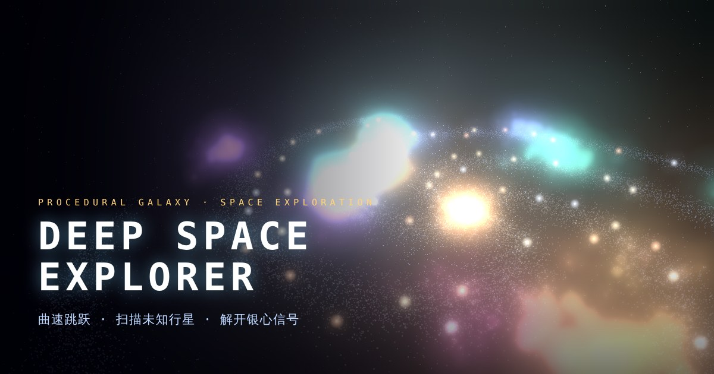

# Deep Space Explorer



驾驶探索飞船穿越一座程序化生成的旋臂星系：跳跃到陌生恒星系，扫描未知行星，收集样本换取信用点，升级飞船，去往更远的深空。主线「银心信号」：收集 7 块先驱者留下的信号碎片，抵达银河中心，扫描那颗奇点。

纯前端项目（Three.js + 原生 ES Modules），无需构建。当前版本：**v0.6.0**

## 玩法

- **探索**：用曲速在恒星系之间跳跃；单星、双星、三星系统各有不同的轨道与光照；行星分岩石、气态、冰巨三类。
- **扫描与收藏**：瞄准行星按住扫描，获得信用点与燃料，并收藏一张行星卡片（K 键查看，可按星系筛选）；同时采样资源进入货舱。
- **货舱与升级**：货舱（I 键）里的材料可以加注燃料、修补船体、作为升级材料，也可以出售换取信用点；信用点和材料用来升级飞船（U 键）。
- **信号**：星系里散布着补给、求救、遗迹、干扰四类信标，强度不同，走近才能识别；干扰信号是陷阱。
- **危险**：恒星耀斑、小行星带、船体失效，越接近银心越危险；银心奇点还有引力潮汐，必须靠近才能扫描。
- **主线**：收集 7 块信号碎片，每块都指向下一个星系，最终前往银河中心。
- **新手教学**：按你的进度分阶段弹出，不用背操作；第一次遇到双星、三星、不同行星类别时，会有对应的知识介绍。

## 操作

| 按键 | 作用 |
| --- | --- |
| 鼠标 | 转向（点击画面锁定鼠标，Esc 释放）；方向键也可转向 |
| W A S D | 前进 / 左移 / 后退 / 右移 |
| Z / C | 上升 / 下降 |
| Q E | 滚转 |
| Shift | 推进加速（消耗能量） |
| Tab / G | 切换目标恒星 / 启动或取消曲速（消耗燃料） |
| 鼠标左键 / F | 瞄准行星并按住扫描 |
| R | 对选中的目标恒星远程探测（消耗燃料） |
| M / J / U / K / I | 银河星图 / 探索日志 / 飞船升级 / 行星收藏 / 货舱 |
| H | 帮助（操作与游戏说明） |
| ← → | 在放大的卡片里查看前一张 / 后一张 |
| Enter / Space | 关闭介绍弹窗、教学中的「继续」 |
| B | 开关辉光效果 |

## 本地运行

项目使用 ES Modules，**不能直接双击 `index.html` 打开**（浏览器会因跨域限制拒绝加载模块），需要用一个本地 HTTP 服务器：

```bash
# 任选其一
python3 -m http.server 8000
npx http-server -p 8000 -c-1
npm start            # 等同于 python3 -m http.server 8000
```

然后访问 <http://localhost:8000>。

> Three.js 通过 jsDelivr CDN 加载（见 `index.html` 里的 importmap），运行时需要联网。

## 部署到 GitHub Pages

1. 把整个文件夹推送到 GitHub 仓库。
2. 仓库 **Settings → Pages**，Source 选 `Deploy from a branch`，分支选 `main`、目录 `/ (root)`。
3. 稍等片刻即可访问 `https://<用户名>.github.io/<仓库名>/`。
4. **分享预览图**：`index.html` 里的 `og:image` / `twitter:image` 目前是相对路径 `assets/thumbnail.jpg`，大多数社交平台要求**完整网址**。部署后请把这两处改成：
   `https://<用户名>.github.io/<仓库名>/assets/thumbnail.jpg`

## 项目结构

```
deep-space-explorer/
├── index.html          页面结构、HUD、面板、importmap
├── css/
│   ├── style.css       基础界面样式
│   └── components.css  弹窗、教学表格、晋升通知等界面片段的样式
├── js/
│   ├── main.js         主程序（只含逻辑）：状态、渲染、LOD、输入、曲速/扫描/任务、主循环
│   ├── text.js         所有显示给玩家的文字：提示、教学、任务、知识介绍、晋升通知
│   ├── templates.js    界面 HTML 模板：弹窗、教学框、日志/货舱/升级表格、示意图
│   ├── constants.js    版本号与全局常量、剧情文本
│   ├── rng.js          可复现的伪随机数（种子）
│   ├── universe.js     程序化生成：星系、背景星、星云、恒星系、行星
│   ├── story.js        主线碎片所在星系的生成规则
│   ├── graphics.js     行星贴图、点云等绘制工具
│   ├── cards.js        行星卡片绘制工具
│   └── audio.js        合成音效（无需音频文件）
└── assets/
    └── thumbnail.jpg   分享预览图（1200×630）
```

## 存档与种子

- 进度保存在浏览器 `localStorage`（键 `deepspace-explorer-save-v1`），辉光偏好键为 `deepspace-bloom`，新手教学进度为 `deepspace-tut3`，已看过的知识介绍为 `deepspace-know`。
- 同一个种子永远生成同一个银河。默认种子 `42`，可用 URL 参数指定，例如 `?seed=1234`；开始界面的「新的银河」会随机换一个。
- 想重新看教学或知识介绍：在帮助面板点「重新开始教学」。
- **注意**：0.4.0 起银河生成有变化，旧版本的存档会与新版不兼容，请开新游戏。

## 更新日志

### 0.6.0
**军衔与主线**
- 新增：军衔与经验系统。从「太空探索实习生」开始，经过初级、中级、高级、资深，到「特级资深探索员」
- 新增：实习生训练——先完成家园星系的全部行星测绘，才能正式授衔；训练期间没有危险事件
- 新增：经验来源——首次扫描行星 +10、拾取信标 +5、收集碎片 +50、完成星系（随军衔递增：30/50/100/200/300）
- 新增：晋升通知弹窗，附军衔徽章（初级 1 星 … 特级 5 星）、经验进度条和新指令；HUD 军衔旁显示星星
- 改进：主线按军衔分批解锁（初级 1 条、中级 2 条、高级 3、4 条、资深 5 条，第 6、7 条与特级资深解锁奇点）
- 改进：主线任务改为「任务指派」口吻，晋升与待命文字更有使命感
- 新增：船体失效被送回家园时降一级军衔（最低降到初级），经验同步下调
- 改进：主恒星不再有异常信号，第一块碎片在其他星系

**教学与知识- 改进：新手教学改为「完成一个步骤，高亮一个」，欢迎提示在第一个移动教学完成后才出现
- 改进：信标教学的四类信号改为表格显示

**界面与其他**
- 改进：新发现的- 新增：奇点引力潮汐
- 修复：晋升弹窗里的经验进度条与「当前/所需经验」不一致
- 修复：升级后主线信标有时要重新进入星系才显示
- 注意：新增了军衔与经验存档字段；旧存档会按已有进度估算经验，建议开新游戏以获得完整体验

- ### 0.5.0
- 新增：第一次进入双星、三星系统时弹出知识介绍（含示意图）
新增：第一次扫描岩石、气态、冰巨行星时，卡片上显示该类行星的介绍，点「知道了」后飞走
- 改进：双星/三星介绍页面重新设计，内容更丰富

### 0.4.0
- 主线：主恒星（Helios-001）不再有主线异常信号，第一块碎片在其他星系
- 新增：扫完一个星系的所有行星，自动提示并打开收藏，筛选到该星系
- 新增：收藏可按星系筛选（全部 / 当前星系 / 指定星系）；放大查看时可用 ← → 浏览前后卡片
- 改进：新发现的卡片和信号碎片在屏幕中央显示，停留后飞向右上角
- 新增：危险红屏提示（耀斑预警、船体低于 30%、奇点潮汐区）
- 新增：奇点引力潮汐：进入潮汐区会被拉向奇点、船体持续受损，进入 90 u 内才能扫描
- 改进：银河中心 200 u 内不再生成星系
- 修复：货舱或其他面板打开时，燃料、船体、信用点的显示不更新
- 注意：银河生成有变化，旧存档与新版不兼容，请开新游戏

### 0.3.0
- 新增：货舱与采样（I 键），扫描行星自动采集资源
- 新增：资源用途——加注燃料、修补船体、升级材料；新增船体系统
- 新增：信号分类（补给、求救、遗迹、干扰）与强度，扫描仪影响发现与识别距离
- 新增：危险事件——恒星耀斑、小行星带、船体失效；越接近银心越危险
- 新增：分阶段新手教学，按触发条件逐步弹出；上升改为 Z 键
- 改进：集齐信号碎片会恢复船体与燃料，并扩大信号发现距离
- 改进：开始界面分为「操作」与「游戏说明」；星图中已到访 / 已探测 / 未知星系的颜色更明显

### 0.2.0
- 新增：行星表面图卡片收藏（K 键查看），含微距生物小图；气态巨行星为云海视角
- 新增：双星、三星系统（恒星按开普勒规律互绕，伴星有标签），卡片里会出现多个太阳
- 改进：行星轨道多样化（椭圆、倾斜、逆行）
- 修复：新游戏的出生点偏离「家园恒星」，开局画面可能被附近恒星的强光过曝

## 路线图

### 0.6.1（计划中）
- [ ] 音响
  - [ ] 升级时
- [ ] 画面
  - [ ] 升级页面
- [ ] 恒星耀斑的发生太过频密
- [ ] 使用真实银河系星系名字与行星资料（类型，数量，位置）
- [ ] 主星用太阳系
- [ ] 加注燃料用不到
- [ ] 扫描奇点之后的结局
 

### 0.7.x（计划中）
- [ ] 增加特殊星系
  - [ ] 高阶聚星系统（4-7 星系统）
  - [ ] X 射线双星
  - [ ] 脉冲星/黑洞系统
- [ ] 增加第二关主线
- [ ] 英文界面

## 许可

本项目采用 PolyForm Noncommercial 1.0.0 许可证，禁止商业用途，详见 [LICENSE](LICENSE)。
