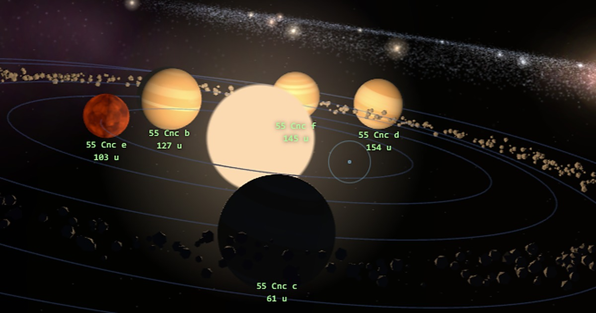

# Deep Space Explorer



驾驶探索飞船穿越一座程序化生成的旋臂星系：跳跃到陌生恒星系，扫描未知行星，收集样本换取信用点，升级飞船，去往更远的深空。主线「银心信号」：收集 7 块先驱者留下的信号碎片，抵达银河中心，扫描那颗奇点。

纯前端项目（Three.js + 原生 ES Modules），无需构建。当前版本：**v0.8.0**

## 玩法

- **探索**：用曲速在恒星系之间跳跃；单星、双星、三星系统各有不同的轨道与光照；行星分岩石、气态、冰巨三类。出发星系是真实的太阳系，银河里还有一批真实存在的恒星系统（比邻星、TRAPPIST-1、Kepler-16 等），数据来自天文观测，界面上用「实测 / 推测 / 生成」标签区分；每局还会随机启用几类特殊现象（红矮星、红巨星、热木星、熔岩行星、海洋世界、超级地球、紧凑多行星、环双星）。
- **扫描与收藏**：瞄准行星按住扫描，获得信用点、燃料与经验，并收藏一张行星卡片（K 键查看，可按星系筛选）；同时采样资源进入货舱。按 P 可以随时拍摄当前星系的全景图，扫完一个星系的全部行星时也会自动拍一张（收藏夹的「星系全景」标签）；全景图上写着主恒星的类型、温度和耀斑范围，不需要再扫描恒星。
- **货舱与升级**：货舱（I 键）里的材料可以加注燃料、修补船体、作为升级材料，也可以出售换取信用点；信用点和材料用来升级飞船（U 键）。
- **信号**：星系里散布着补给、求救、遗迹、干扰四类信标，强度不同，走近才能识别；干扰信号是陷阱。
- **危险**：恒星耀斑与高温区（越近越危险）、小行星带、船体失效，越接近银心越危险；银心奇点还有引力潮汐，必须靠近才能扫描。
- **主线**：收集 7 块信号碎片，每块都指向下一个星系，最终前往银河中心。
- **知识库**：按 L 打开。第一次遇到的恒星类型、行星类别、双星三星、真实星系、小行星带、耀斑等，会弹出介绍并收进知识库，没遇到过的不显示；「基础知识」里还有行星卡上 AU、R⊕、M⊕ 等天文单位的说明。
- **新手教学**：按你的进度分阶段弹出，不用背操作。

## 操作

| 按键 | 作用 |
| --- | --- |
| 鼠标 | 转向（点击画面锁定鼠标，Esc 释放）；方向键也可转向 |
| W A S D | 前进 / 左移 / 后退 / 右移 |
| Z / C | 上升 / 下降 |
| Q E | 滚转 |
| Shift | 推进加速（消耗能量） |
| Tab / G | 切换目标恒星 / 启动或取消曲速（消耗燃料） |
| 鼠标左键 / F | 瞄准行星（或银心奇点）并按住扫描 |
| R | 对选中的目标恒星远程探测（消耗燃料） |
| M / J / U  | 银河星图 / 探索日志 / 飞船升级 |
| K / I / L | 收藏 / 货舱 / 知识库 |
| P | 拍摄当前星系的全景图 |
| H | 帮助（操作与游戏说明） |
| ← → | 在放大的卡片里查看前一张 / 后一张 |
| Enter / Space | 关闭介绍弹窗、教学中的「继续」 |
| B | 开关辉光效果 |

## 本地运行

项目使用 ES Modules，**不能直接双击 `index.html` 打开**（浏览器会因跨域限制拒绝加载模块），需要用一个本地 HTTP 服务器：

```bash
# 任选其一
python3 -m http.server 8000
npx http-server -p 8000 -c-1
npm start            # 等同于 python3 -m http.server 8000
```

然后访问 <http://localhost:8000>。

> Three.js 通过 jsDelivr CDN 加载（见 `index.html` 里的 importmap），运行时需要联网。

## 部署到 GitHub Pages

1. 把整个文件夹推送到 GitHub 仓库。
2. 仓库 **Settings → Pages**，Source 选 `Deploy from a branch`，分支选 `main`、目录 `/ (root)`。
3. 稍等片刻即可访问 `https://<用户名>.github.io/<仓库名>/`。
4. **分享预览图**：`index.html` 里的 `og:image` / `twitter:image` 目前是相对路径 `assets/thumbnail.jpg`，大多数社交平台要求**完整网址**。部署后请把这两处改成：
   `https://<用户名>.github.io/<仓库名>/assets/thumbnail.jpg`

## 项目结构

```
deep-space-explorer/
├── index.html          页面结构、HUD、面板、importmap
├── css/
│   ├── style.css       基础界面样式
│   └── components.css  弹窗、教学表格、晋升通知等界面片段的样式
├── js/
│   ├── main.js         主程序（只含逻辑）：状态、渲染、LOD、输入、曲速/扫描/任务、主循环
│   ├── text.js         所有显示给玩家的文字：提示、教学、任务、知识介绍、晋升通知
│   ├── templates.js    界面 HTML 模板：弹窗、教学框、日志/货舱/升级表格、示意图
│   ├── constants.js    版本号与全局常量、剧情文本
│   ├── rng.js          可复现的伪随机数（种子）
│   ├── universe.js     程序化生成：星系、背景星、星云、恒星系、行星
│   ├── real.js         太阳系的真实数据
│   ├── realsystems.js  真实星系库（恒星、行星资料）、抽样与按数据生成恒星行星
│   ├── story.js        主线碎片所在星系的生成规则
│   ├── graphics.js     行星贴图、点云等绘制工具
│   ├── cards.js        行星卡片与星系全景图的绘制工具
│   └── audio.js        合成音效（无需音频文件）
└── assets/
    └── thumbnail.jpg   分享预览图（1200×630）
```

## 存档与种子

- 进度保存在浏览器 `localStorage`（键 `deepspace-explorer-save-v1`），辉光偏好键为 `deepspace-bloom`，新手教学进度为 `deepspace-tut3`，已看过的知识介绍为 `deepspace-know`，知识库已解锁的条目为 `deepspace-lib`（及 `deepspace-libseen`）。
- 同一个种子永远生成同一个银河。默认种子 `42`，可用 URL 参数指定，例如 `?seed=1234`；开始界面的「新的银河」会随机换一个。
- 想重新看教学或知识介绍：在帮助面板点「重新开始教学」（不会清空知识库里已解锁的条目）。
- 测试用 URL 参数：`?kb=reset` 清空知识库，`?kb=all` 解锁全部条目。
- **注意**：0.4.0 起银河生成有变化，旧版本的存档会与新版不兼容，请开新游戏。0.7.0 又加入了真实星系，0.8.0 把银河放大并拉开了星系间距，同一个种子的银河布局和星系都与旧版不同，旧存档请开新游戏。

## 更新日志

### 0.8.0
**银河与星系**
- 改进：银河半径放大到 1100，星系之间至少相隔 200（原来 150，经常挨得太近），星系数量不变；背景星点相应增加
- 改进：曲速途中路过别的星系不再弹出提示和介绍，到达目标星系后才触发
- 改进：星系全景图里的行星轨道按游戏里的真实参数绘制（离心率、倾角、升交点方向，恒星在焦点上），每条轨道一个颜色

**行星卡与全景图**
- 改进：太阳系行星、系外行星、生成行星的卡片统一格式，都有半径、质量、轨道、周期；卫星数放在副标题；数值按来源上色（绿 = 实测，黄 = 推测，灰蓝 = 生成），项目名称统一颜色
- 改进：行星卡不再写「双星 / 三星系统」，这类星系信息放在全景图里
- 改进：选择行星卡时，在星系里默认只显示当前星系，不在星系里则显示全部
- 新增：扫完一个星系的全部行星，自动拍下全景图，并在行星卡飞走后弹出全景放大图（原来是固定时间后弹出收藏页，卡片还没飞走就出现了）
- 新增：「星系全景」可以按「最新在前」或「按名字」排序
- 改进：**取消扫描主恒星**；全景图右上角直接显示主恒星的类型、温度、耀斑频率和熔毁区 / 耀斑区范围（真实恒星还有半径、质量、距离）

**知识库与介绍**
- 新增：「基础知识」分组，介绍天文单位（AU、R⊕ / M⊕、光年，以及秒差距、太阳 / 木星质量半径等），第一次扫描行星后解锁
- 改进：知识库窗口加高加宽，示意图和列表压紧，大多数条目不再需要滚动
- 改进：11 个真实星系的条目标题加「星系」后缀，副标题写明是哪一颗行星；单独弹出时标注「🌍 真实星系」，分清星系和行星
- 改进：一次进入星系触发多条介绍时，只弹优先级最高的一个窗口，其余做成「同时遇到」补充块附在里面（不再静默解锁）；优先级为 双星 / 三星 > 紧凑多行星 > 红矮星 / 红巨星 > 恒星类型
- 改进：扫描银心奇点后，先弹出黑洞介绍，关闭后再进入结局
- 改进：新手教学的第 2 阶段增加「L 打开知识库」；右下角按键提示只保留有页面的按键

**界面与经验**
- 改进：军衔晋升弹窗改为金色主题，与知识 / 介绍页面区分
- 改进：升级门槛调整为 150 / 500 / 1200 / 2500 / 4000；取消主恒星扫描的经验（原来每颗 +20，新类型 +30）
- 注意：银河布局变了，旧存档请开新游戏

### 0.7.0
**真实星系与现象**
- 新增：出发星系改为真实的太阳系（轨道、卫星数、小行星带用真实数据）；地球不需要扫描，自动收藏地球卡片（有植物、动物和人类）
- 新增：11 个真实星系（比邻星、TRAPPIST-1、51 Peg、HD 209458、55 Cnc、Kepler-16、Kepler-90、Kepler-186、TOI-700、LHS 1140、Kepler-452），名字和行星数据来自天文观测，只含已知行星
- 新增：数据标签 实测 / 推测 / 生成，候选行星单独标注；卡片、日志里都有
- 新增：8 类现象（红矮星、红巨星、热木星、熔岩行星、海洋世界、超级地球、紧凑多行星、环双星），每局随机启用 2～3 类，外观和规则各不相同
- 改进：卫星数量按比例显示，最多 12 颗；还没扫描的行星不再显示名称

**知识库**
- 新增：知识库（L 键），按分组收集已解锁的条目，没遇到的不显示，条目带示意图
- 新增：G / F / K / A 型恒星、红矮星、红巨星、行星类别（热木星、熔岩、海洋、超级地球）、紧凑多行星、11 个真实星系、小行星带、行星环与卫星、恒星耀斑、黑洞（扫描奇点后解锁）的介绍
- 改进：一次进入星系触发多条介绍时只弹一个窗口，其余静默解锁

**恒星、全景图与危险**
- 新增：扫描主恒星（离恒星 3～7 倍半径），得到恒星卡片；耀斑预警时扫描会被打断
- 新增：星系全景图（P 键），已扫描的行星画实心、没扫描的只画轨道；收藏夹新增「星系全景」标签；收集 5 / 10 / 20 个星系的全景图有信用点奖励
- 新增：恒星高温区，离恒星约 2.6 倍半径以内船体持续受损
- 改进：耀斑的概率和伤害随距离变化，越近越危险

**经验与军衔**
- 改进：经验重新平衡：升级门槛 150 / 500 / 1100 / 2000 / 3400；完成星系改为固定 40 + 每颗行星 5；首次扫描行星按类型 8～25；碎片 +100、信标 +8
- 新增：扫描主恒星 +20、拍摄星系全景 +10、第一次解锁知识库条目 +15
- 注意：旧存档军衔不变，经验会按本级进度折算到新门槛

### 0.6.0
**军衔与主线**
- 新增：军衔与经验系统。从「太空探索实习生」开始，经过初级、中级、高级、资深，到「特级资深探索员」
- 新增：实习生训练——先完成家园星系的全部行星测绘，才能正式授衔；训练期间没有危险事件
- 新增：经验来源——首次扫描行星 +10、拾取信标 +5、收集碎片 +50、完成星系（随军衔递增：30/50/100/200/300）
- 新增：晋升通知弹窗，附军衔徽章（初级 1 星 … 特级 5 星）、经验进度条和新指令；HUD 军衔旁显示星星
- 改进：主线按军衔分批解锁（初级 1 条、中级 2 条、高级 3、4 条、资深 5 条，第 6、7 条与特级资深解锁奇点）
- 改进：主线任务改为「任务指派」口吻，晋升与待命文字更有使命感
- 新增：船体失效被送回家园时降一级军衔（最低降到初级），经验同步下调
- 改进：主恒星不再有异常信号，第一块碎片在其他星系

**教学与知识**
- 改进：新手教学改为「完成一个步骤，高亮一个」
改进：欢迎提示在第一个移动教学完成后才出现
- 改进：信标教学的四类信号改为表格显示

**界面与其他**
- 改进：新发现的- 新增：奇点引力潮汐
- 修复：晋升弹窗里的经验进度条与「当前/所需经验」不一致
- 修复：升级后主线信标有时要重新进入星系才显示
- 注意：新增了军衔与经验存档字段；旧存档会按已有进度估算经验，建议开新游戏以获得完整体验

### 0.5.0
- 新增：第一次进入双星、三星系统时弹出知识介绍（含示意图）
新增：第一次扫描岩石、气态、冰巨行星时，卡片上显示该类行星的介绍，点「知道了」后飞走
- 改进：双星/三星介绍页面重新设计，内容更丰富

### 0.4.0
- 主线：主恒星（Helios-001）不再有主线异常信号，第一块碎片在其他星系
- 新增：扫完一个星系的所有行星，自动提示并打开收藏，筛选到该星系
- 新增：收藏可按星系筛选（全部 / 当前星系 / 指定星系）；放大查看时可用 ← → 浏览前后卡片
- 改进：新发现的卡片和信号碎片在屏幕中央显示，停留后飞向右上角
- 新增：危险红屏提示（耀斑预警、船体低于 30%、奇点潮汐区）
- 新增：奇点引力潮汐：进入潮汐区会被拉向奇点、船体持续受损，进入 90 u 内才能扫描
- 改进：银河中心 200 u 内不再生成星系
- 修复：货舱或其他面板打开时，燃料、船体、信用点的显示不更新
- 注意：银河生成有变化，旧存档与新版不兼容，请开新游戏

### 0.3.0
- 新增：货舱与采样（I 键），扫描行星自动采集资源
- 新增：资源用途——加注燃料、修补船体、升级材料；新增船体系统
- 新增：信号分类（补给、求救、遗迹、干扰）与强度，扫描仪影响发现与识别距离
- 新增：危险事件——恒星耀斑、小行星带、船体失效；越接近银心越危险
- 新增：分阶段新手教学，按触发条件逐步弹出；上升改为 Z 键
- 改进：集齐信号碎片会恢复船体与燃料，并扩大信号发现距离
- 改进：开始界面分为「操作」与「游戏说明」；星图中已到访 / 已探测 / 未知星系的颜色更明显

### 0.2.0
- 新增：行星表面图卡片收藏（K 键查看），含微距生物小图；气态巨行星为云海视角
- 新增：双星、三星系统（恒星按开普勒规律互绕，伴星有标签），卡片里会出现多个太阳
- 改进：行星轨道多样化（椭圆、倾斜、逆行）
- 修复：新游戏的出生点偏离「家园恒星」，开局画面可能被附近恒星的强光过曝

## 路线图
# 1.0.0 (第一版发布）

  - [ ] 知识库增加quiz 玩家通过quiz 可以更快晋升（加经验值）
  - [ ] 扫描奇点，太靠近会被吸进去（game over)，添加警告
    - [ ] 画一个飞船在无尽的黑暗里漂浮，有“重新开始”和“新的银河”的按钮。 
 
  - [ ] 成功扫描奇点并脱困后：
    - [ ] 显示一个恭喜画面，可继续探索或结束游戏。
      - [ ] 扫描奇点，该得到神秘能力
  - [ ] 优化音响（含升级时的音效）
  

- [ ] 脉冲星/黑洞系统
- [ ] 增加增加特殊星系
  - [ ] 高阶聚星系统（4-7 星系统）
  - [ ] 第二关主线
- [ ] 英文界面
- [ ] 模拟卫星碰撞事件
- [ ] 收集/栽培生命样本

## 许可

本项目采用 PolyForm Noncommercial 1.0.0 许可证，禁止商业用途，详见 [LICENSE](LICENSE)。
